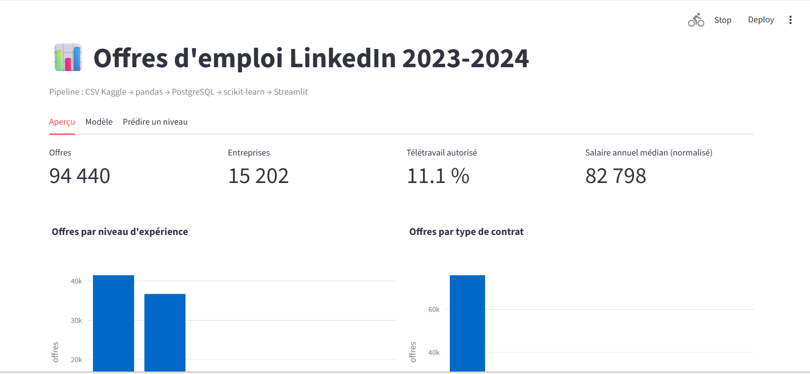
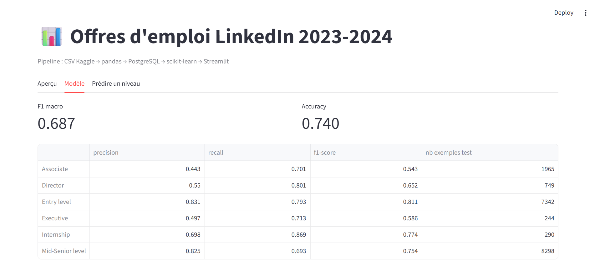
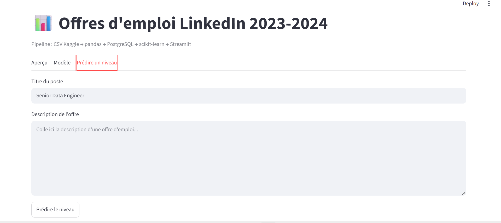

# Job Offers Data Pipeline

Pipeline de données complet sur 123 849 offres d'emploi LinkedIn (2023-2024) : nettoyage, stockage, modèle de machine learning et tableau de bord.

**Objectif du modèle :** prédire le niveau d'expérience demandé (Internship, Entry level, Associate, Mid-Senior level, Director, Executive) à partir du titre et de la description d'une offre.

## Architecture

```
CSV Kaggle → pandas (nettoyage) → PostgreSQL → scikit-learn (TF-IDF + régression logistique) → Streamlit
```

## Stack technique

Python 3.10 · pandas · PostgreSQL 16 · SQLAlchemy · scikit-learn · Streamlit · Plotly · pytest · Docker · GitHub Actions

## Résultats

| Métrique | Valeur |
|---|---|
| Accuracy | 0,74 |
| F1 macro | 0,687 |

Les classes sont déséquilibrées (Mid-Senior : 41 489 offres, Executive : 1 222). Le modèle utilise `class_weight="balanced"`, un découpage stratifié et le F1 macro comme métrique principale.

## Aperçu





## Structure du projet

```
├── src/
│   ├── clean.py      # nettoyage pandas
│   ├── db.py         # connexion PostgreSQL
│   ├── load.py       # chargement dans la base
│   └── train.py      # entraînement du modèle
├── dashboard/app.py  # tableau de bord Streamlit
├── tests/            # tests pytest
├── Dockerfile
├── docker-compose.yml
└── .github/workflows/ci.yml
```

## Lancer le projet

1. Télécharger le dataset **LinkedIn Job Postings (2023 - 2024)** sur Kaggle et placer `postings.csv` dans `data/raw/`.
2. Créer un fichier `.env` à partir de `.env.example`.
3. Installer les dépendances :

```bash
python -m venv .venv
source .venv/bin/activate   # Windows : .venv\Scripts\activate
pip install -r requirements.txt
```

4. Exécuter le pipeline :

```bash
docker compose up -d db
python -m src.clean
python -m src.load
python -m src.train
```

5. Lancer le dashboard :

```bash
docker compose up -d --build
```

Dashboard disponible sur http://localhost:8501

## Tests

```bash
pytest -v
```

Les tests sont exécutés automatiquement à chaque push via GitHub Actions.

## Pistes d'amélioration

- Traiter le titre séparément de la description dans le vectoriseur
- Tester d'autres modèles (SVM linéaire, gradient boosting)
- Orchestrer le pipeline avec un planificateur (Airflow, cron)
